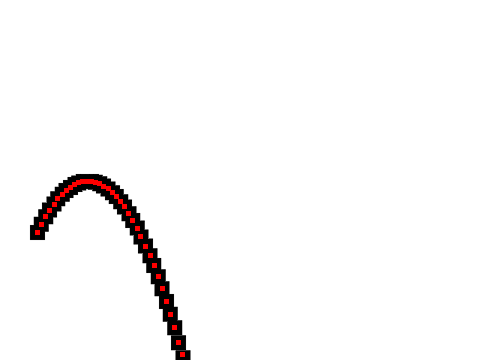
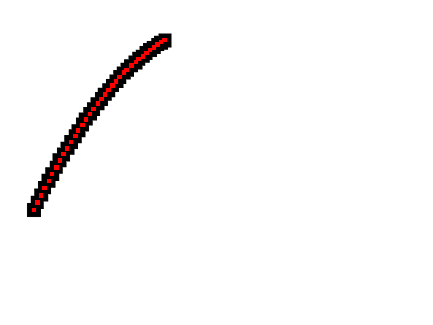

# E2E Audit Flow Verification Report (T42)

Generated automatically by `scripts/e2e_audit.py`.

## Summary
- **Case 1 (Normal Gravity g = 9.81 m/s²)**:
  - **Verdict**: `consistent`
  - **Apparent Gravity**: `9.19 m/s²` (g_vs_earth: `0.94`)
  - **Matched Celestial Body**: `Earth`
  - **Overlay Image**: 

## Case 2 (Slow Gravity g/4 = 2.45 m/s²)**:
  - **Verdict**: `inconsistent`
  - **Apparent Gravity**: `2.32 m/s²` (g_vs_earth: `0.24`)
  - **Matched Celestial Body**: `Moon`
  - **Reasons**: `apparent g 2.32 m/s^2 is outside 8.34-11.28`
  - **Overlay Image**: 

Both test cases successfully verified the end-to-end audit API pipeline.
